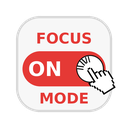

# Focus Button for YouTube



A small browser extension that adds a **Focus** toggle to YouTube's top bar.

When Focus mode is on, it hides:

- Comments on video pages
- Related videos beside the player
- Recommendations on the YouTube home page
- The Shorts player/feed
- Shorts shelves and individual Shorts in search results
- The notification bell while preserving its space in the top bar

The setting changes immediately without reloading and is remembered between
visits. Search results, subscriptions, channels, and playlists remain available.
The switch is available throughout YouTube wherever its standard top bar is
present.

## Development

Requires Node.js 22 or newer.

```bash
npm install
npm run dev
```

For Firefox development:

```bash
npm run dev:firefox
```

## Build

```bash
npm run check
npm run build:all
```

Build outputs:

- Chrome: `.output/chrome-mv3/`
- Firefox: `.output/firefox-mv2/`

To create store-ready ZIP files:

```bash
npm run zip:all
```

## Test an unpacked build

### Chrome

1. Open `chrome://extensions`.
2. Enable **Developer mode**.
3. Choose **Load unpacked**.
4. Select `.output/chrome-mv3/`.
5. Open or refresh YouTube.

### Firefox

1. Open `about:debugging#/runtime/this-firefox`.
2. Choose **Load Temporary Add-on**.
3. Select `.output/firefox-mv2/manifest.json`.
4. Open or refresh YouTube.

## Privacy

Focus Button does not collect or transmit data. It stores only the on/off state
locally in the browser. See [PRIVACY.md](PRIVACY.md).

YouTube is a trademark of Google LLC. This project is not affiliated with or
endorsed by Google or YouTube.
